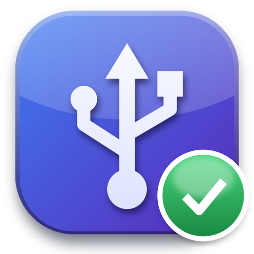

## دانلود / Download

| فایل / File | توضیح / Description |
|---|---|
| **`USB-Fixer-Setup.exe`** | نسخهٔ نصبی (پیشنهادی) · Installer (recommended) |
| `USB-Fixer.exe` | نسخهٔ تک‌فایلی بدون نصب · Portable, no install |
| `SHA256SUMS.txt` | هش فایل‌ها برای اطمینان از سالم بودن · File checksums |

ویندوز ۱۰/۱۱ (۶۴ بیتی) · Windows 10/11 (64-bit)

> **هشدار SmartScreen:** فایل‌ها امضای دیجیتال ندارن، پس ویندوز ممکنه هشدار بده. روی **More info** و بعد **Run anyway** بزن.
> **SmartScreen:** the files are not code-signed yet; click **More info → Run anyway**.

## تازه‌های نسخهٔ ۱.۰ / What's new in 1.0
- **تست زنده دیگه حافظهٔ بی‌درایو رو «سالم» نمی‌دونه.** اگه فلش یا هارد وصل بشه ولی تو This PC نیاد، دلیلش رو جدا می‌گه: دیسکی ساخته نشده، کارت‌خوان خالیه، دیسک راه‌اندازی نشده یا پارتیشن نداره. فلش‌های UASP و پارتیشن‌های FAT32 بی‌حرف هم دیده می‌شن.
- **تشخیص قطع شدن گاه‌وبی‌گاه:** اگه تو هفتهٔ اخیر فلش یا هارد USB وسط کار قطع شده باشه، اسکن تعداد و روزهاش رو نشون می‌ده و می‌گه کجا رو چک کنی (مثلاً کابل پورت‌های جلوی کیس).
- **لاگ تمیزتر:** خطاهای دستگاه‌های غیر USB (مثل دوربین Windows Hello) دیگه جزو خطاهای USB نشون داده نمی‌شن.

- The live test no longer calls a storage device with no drive letter "healthy", and says why it is missing.
- New: storage drop-outs from the last week (disk 51/153/157) are counted per day, with front-panel cable advice.
- Non-USB Kernel-PnP errors are no longer reported as USB errors.

## چه کار می‌کنه؟
مشکلات درگاه‌ها و دستگاه‌های USB رو پیدا می‌کنه، مادربرد و چیپست رو می‌شناسه، BIOS رو آنلاین از سایت سازنده چک می‌کنه، با «تست زنده» می‌گه مشکل سخت‌افزاریه یا نرم‌افزاری، و فقط با تأیید تو رفعشون می‌کنه. قبل از هر تغییر نقطهٔ بازیابی و پشتیبان می‌سازه و همه‌چیز قابل برگشته.

Finds and fixes USB port/device problems, identifies your motherboard and chipset, checks the BIOS online, tells hardware from Windows problems with a live plug-in test, and changes nothing without your confirmation (restore point + exact undo).

---
ساخته‌شده توسط **عرفان اسمعیل زاده (Erfan Esmailzadeh)** · [github.com/kterfan](https://github.com/kterfan)
